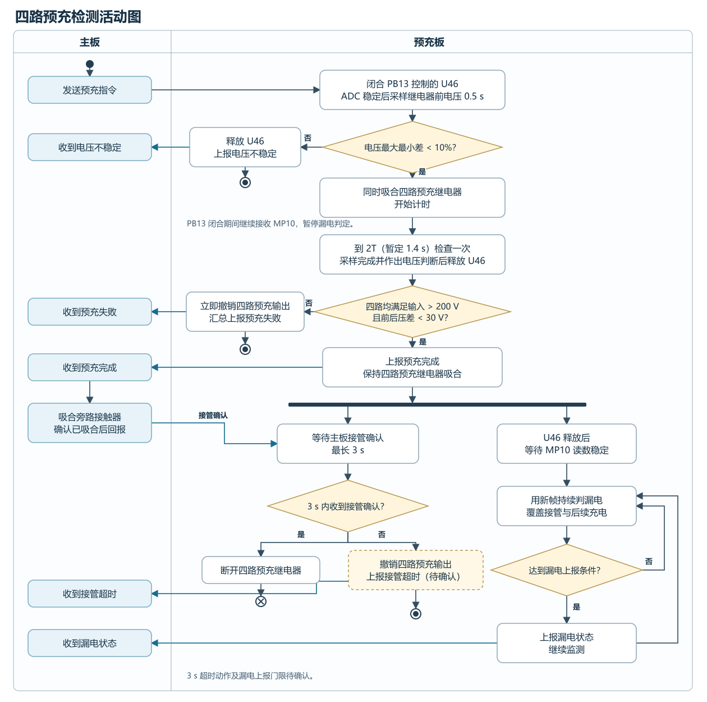

# 假负载主控板与预充板通信协议

**V0.1 评审稿 · 2026-11-17**

## 1 适用范围

本协议定义假负载主控板与四路预充板之间的 RS485 通信，包含预充控制、心跳、状态上报三类交互。

## 2 串口参数和帧格式

| 项目 | 约定 |
|---|---|
| 连接 | 点对点 RS485，半双工 |
| 串口参数 | 9600 bit/s，8 数据位，偶校验，1 停止位（8E1）。 |
| 总线发起方 | 主控发起预充控制，预充板主动发起心跳和状态上报 |

帧字段顺序和校验沿用《充电桩产线测试协议 V1.2.7》

| 字节偏移 | 字段 | 长度 | 定义 |
|---:|---|---:|---|
| 0 | Header | 2 | 固定 `0D 0A` |
| 2 | CheckSUM | 1 | 从 Length 的第一个字节至 Data 最后一个字节累加，取低 8 位。Data 为空时累加到 Command ID |
| 3 | Length | 2 | 整帧长度，大端，等于 `8 + Data 字节数` |
| 5 | Direction | 1 | `55` 主控 → 预充板，`AA` 预充板 → 主控 |
| 6 | Type | 1 | 类别 |
| 7 | Command ID | 1 | 类别内的命令 |
| 8 | Data | 0～512 | 本版本使用二进制字段。多字节整数小端，有符号整数用补码 |

长度小于 8 或大于 520 的帧、校验错误的帧、方向错误的帧均丢弃。命令按本表定义的 Data 长度解码。字段偏移从 Data 的第一个字节起算。报文中的十六进制数字表示逐字节传输。

## 3 报文定义

Type、Command ID 和上报码为本评审稿分配。相同交互的请求与应答使用同一个 Type 和 Command ID，以 Direction 区分。

| 类别 | Type | Command ID | 主控 → 预充板 | 预充板 → 主控 | 说明 |
|---|---:|---:|---|---|---|
| 控制 | `03` | `01` | 无 | `Result`（1 字节，） | 预充启动 |
| 控制 | `03` | `02` | 无 | `Result`（1 字节） | 预充结束  |
| 控制 | `03` | `03` | 无 | `Result`（1 字节） | 复位(清除故障) |
| 心跳 | `02` | `01` | `UnixSeconds`（4 字节） | 无 | 发送间隔3秒，如果连续3个周期未收到心跳，认为预充板掉线 |
| 状态上报 | `04` | `01` | `ReportSeq`（2 字节） | `Report` |变长，具体见 3.1 节 |

应答结果 `Result`：

| 值 | 含义 |
|---:|---|
| `00` | 已受理，或同一操作此前已受理 |
| `01` | 忙，已有活动预充 |
| `02` | 当前状态不接受该操作 |
| `04` | 预充板未就绪或无法开始预充 |
| `05` | 参数无效 |

时间戳 `UnixSeconds`：

从 **1970-01-01 00:00:00 UTC** 到当前时刻经过的秒数。它占应答 Data 的全部 4 字节，类型为无符号 32 位整数，按小端发送，最低有效字节在前。

### 3.1 状态上报数据 `Report`

| 偏移 | 字段 | 类型 | 定义 |
|---:|---|---|---|
| 0 | ReportSeq | u16 | 由预充板维护，每产生一条新上报递增一次，重发沿用原序号。 |
| 2 | Event | u8 | `01` 预充完成，`02` 故障 |
| 3 | Cause | u8 | 故障原因，仅event为“故障”时有效 |
| 4 起 | FaultData | 故障数据 | ，具体编码见下方 Cause 表 |

**预充完成（Event=01）**表示电压检查通过，预充输出保持吸合，等待主控接管。

**故障（Event=02）**携带 Cause 和对应的 FaultData。整帧长度为 `12 + FaultData 字节数`。

| Cause | 故障原因 | FaultData |
|---:|---|---|
| `01` | 输入电压检查失败 | `ChannelMask:u8`，1 字节 |
| `02` | 预充电压判定失败 | `ChannelMask:u8`，1 字节 |
| `03` | 漏电互感器故障   | `ChannelMask:u8`，1 字节 |
| `04` | 漏电超限 | `ChannelMask:u8`，随后按通道号从小到大发送置位通道的电流，每路 `i16`、单位 0.1 mA |
| `05` | 预充板内部故障 | 空 |

`ChannelMask` 的 bit 0～3 依次对应 CH1～CH4，bit 4～7 置零。整板故障或无法定位通道时，位图可为 0。漏电故障的位图至少置一位，只携带已确认超限通道的有效电流值，因此其 FaultData 长度为 `1 + 2 × 置位通道数`。漏电阈值和持续时间待整机确定。

主控默认预充板正常。漏电互感器确认故障时，上报本次确认的故障通道。上电期间等待设备上线或自检时无需发送正常状态，恢复时也无需另发报文。仅发送表中列出的故障类别。

### 3.2 应答报文

| 应答报文 | Direction | Type | Command ID | 整帧 Length | Data 格式 |
|---|---|---|---|---|---|
| 启动预充应答 | `AA` | `03` | `01` | `00 09` | `Result:u8` |
| 停止应答 | `AA` | `03` | `02` | `00 09` | `Result:u8` |
| 心跳请求 | `AA` | `02` | `01` | `00 08` | 无 Data |
| 心跳应答 | `55` | `02` | `01` | `00 0C` | `UnixSeconds:u32` |
| 状态上报应答 | `55` | `04` | `01` | `00 0A` | 原样回送 `ReportSeq:u16` |

状态上报应答的 Data 偏移 0～1 为原上报序号，按小端编码。主控收到故障上报后应答。对于 `Event=01` 的预充完成上报，主控在确认旁路已吸合后才应答。预充板收到匹配应答后执行释放，释放失败时主动上报故障。

## 4 交互和超时

1. **启动。** 主控发送启动请求，预充板返回受理结果。
2. **检测。** 预充板接通 PB13 控制的 U46，稳定后进行 0.5 s 输入检查。四路吸合后在暂定的 `2T = 1.4 s` 检查一次。判断结束后释放 U46。检查失败时撤销预充输出，主动上报故障原因及对应数据，主控应答。
3. **接管。** 检查通过时，预充板主动上报预充完成，保持四路预充继电器吸合。主控确认旁路实际吸合后，回送原上报序号。预充板收到匹配应答后释放四路，失败时主动上报释放故障，主控应答。
4. **超时和停止。** 当前联调实现从本地发布预充完成事件起计 3 s。有效应答须在时限内到达。超时则尝试撤销四路并主动上报接管超时。收到停止请求时，预充板应答受理，撤销四路并释放 U46，操作失败时主动上报故障。
5. **漏电。** U46 闭合期间持续接收 MP10，暂停漏电判定。释放并稳定后用新帧判断。达到漏电上报条件时主动上报，主控应答。
6. **心跳。** 预充板每 3 秒在总线空闲时发送 `AA 02 01`，Data 为空。主控回复 `55 02 01`，Data 为当前 UTC Unix 秒数，4 字节小端（自 1970-01-01 00:00:00 UTC 起的秒数）。联调时从请求发送完成起等待 100 ms，预充板在窗口内暂停主动状态上报，只处理本次首条心跳应答。主控时差绝对值达到 5 秒时同步 RTC。RTC 未设时则用首条有效时间初始化。RTC 支持 2000～2099 年。

## 5 报文示例

以下为完整帧。

| 交互 | 十六进制报文 |
|---|---|
| 启动预充 | `0D 0A 61 00 08 55 03 01` |
| 启动已受理 | `0D 0A B7 00 09 AA 03 01 00` |
| 停止 | `0D 0A 62 00 08 55 03 02` |
| 停止已受理 | `0D 0A B8 00 09 AA 03 02 00` |
| 预充板心跳请求 | `0D 0A B5 00 08 AA 02 01` |
| 主控心跳应答，2026-11-26 00:00:00 UTC | `0D 0A CC 00 0C 55 02 01 80 76 07 6B` |
| 预充完成上报，序号 1 | `0D 0A BC 00 0B AA 04 01 01 00 01` |
| 主控确认旁路吸合后应答 | `0D 0A 65 00 0A 55 04 01 01 00` |
| 预充失败上报，序号 2，第 2 路电压不合格 | `0D 0A C4 00 0D AA 04 01 02 00 02 02 02` |
| 主控应答预充失败上报 | `0D 0A 66 00 0A 55 04 01 02 00` |
| 漏电故障上报，序号 3，第 1 路 +32.0 mA | `0D 0A 09 00 0F AA 04 01 03 00 02 04 01 40 01` |
| 主控应答漏电故障上报 | `0D 0A 67 00 0A 55 04 01 03 00` |

## 6 参考文件

《充电桩产线测试协议 V1.2.7》第 2.3 节和附录 C。
