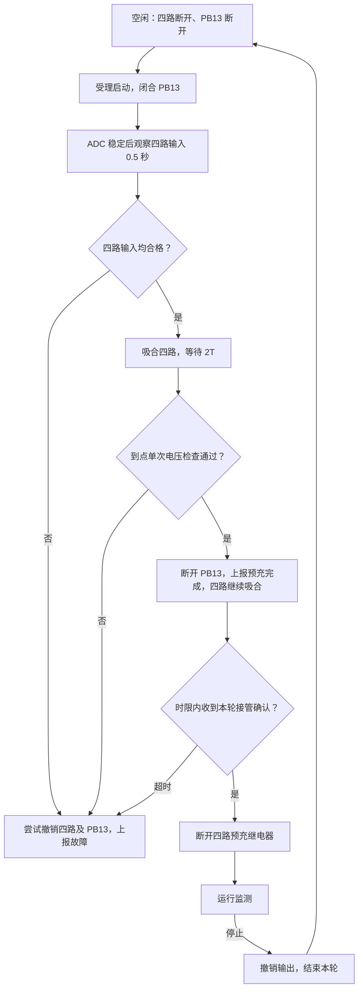

# 四路预充任务设计说明书

**评审稿 · 2026-11-19**

## 0. 文档说明

| 项目 | 内容 |
|---|---|
| 文档状态 | 首版设计评审稿。接口名称和数据组织是设计提案 |
| 适用范围 | 预充板的预充任务，包含四路预充控制、MP10 自检、漏电判定和运行灯。485 与 BSP 仅说明接口边界 |
| 事实来源 | 已确认的硬件流程、板级接线、主板通信协议评审稿及联调记录 |
| 文档组织参考 | C2《PTL 设计和使用说明》。采用其模块边界、数据流、接口契约、使用限制和验证清单的写法 |

首版包含预充、接管、四路漏电判定和上报闭环。MP10 不可用时标记对应通道，由主板决定是否启动。调试版保留 PB3～PB6 直控，实验人员负责隔离自动预充。漏电判定参数待补充。

预充任务负责三个动作：检查四路电压并控制预充继电器，与四台 MP10 通信并判断漏电，维护运行灯。主板负责旁路接触器和整机联锁。485 任务是预充任务的外部调用方，通过接口提交动作、领取结果。

## 1. 模块说明与任务划分

本模块交付的是四路共同预充的控制流程。启动、停止、接管都以整轮为单位，电压和漏电结果可以追溯到单路。

| 单元 | 运行位置 | 负责的事 |
|---|---|---|
| 预充控制 | 预充任务 | 处理启动、停止与接管确认，控制 PB13 和四路继电器，决定何时读取 ADC 和何时撤销 |
| MP10 与漏电判断 | 同一个预充任务 | 管理四台设备的上线、自检和测量，根据 PB13 状态决定数据能否参与漏电判断 |
| 运行灯 | 同一个预充任务 | 按周期翻转运行灯 |
| 主板通信 | 独立的 485 任务 | 解析报文、回复心跳、提交控制动作、发送结果、匹配上报应答 |
| 板级驱动 | BSP 和设备驱动 | 提供继电器、PB13、ADC、CAN 和串口操作。ADC 连续采集，提供一轮四对回读的快照 |

预充板工程包含预充任务和 485 通信任务。本文设计的是前者。四路预充控制和 MP10 处理在同一个预充任务内执行。每轮先处理停止和到期的控制动作，再处理有限量的 CAN 事件，最后更新运行灯并报告看门狗进度。CAN 回调只交付事件，设备处理留在线程内。预充任务周期和最坏响应时延通过联调确定。


### 1.1 目录与初始化

以下是拟定目录。模块之间只包含公共头文件。

```text
inc/precharge.h          对外动作和事件接口
precharge/precharge.c    初始化、任务入口、运行灯
precharge/control.c      阶段转换、电压判断和输出撤销
precharge/mp10.c         CAN 帧解释、上线与自检
precharge/leakage.c      连续超限判断、漏电事件
```

启动顺序为板级输出进入非有效态 → ADC 与 CAN 就绪 → 创建预充任务 → 预充任务注册看门狗并启动 MP10 接收 → 发布服务就绪和初始通道可用性。ADC 或输出控制未就绪时不受理启动。MP10 接收初始化失败时标记四路不可用，启动决策仍归主板。

### 1.2 数据流

```text
主板 -> 485 任务 -> 启动 / 停止 / 接管接口 -> 预充任务
ADC 快照 ----------------------------------> 预充任务 -> 四路继电器、PB13、运行灯
MP10 -> CAN 回调 -> 有界事件缓冲 -----------> 预充任务
主板 <- 485 编码、应答和重发 <- 事件副本 <--- 预充任务
```
## 2. 预充流程图



任一阶段收到停止指令，都优先撤销输出。图中所有硬件操作失败均进入故障处理，撤销失败时保留故障并拒绝再次启动。PB13 断开并稳定后，漏电判断即可在等待接管阶段开始，并延续到运行监测。

## 3. 一轮预充从哪里开始，到哪里结束

主板发来启动指令，预充板先回复是否受理。**受理只表示开始处理，主板此时还不能接管。** 四路属于同一轮，任何一路判定失败，都结束整轮预充。

| 阶段 | 预充板做什么 | 下一步怎么决定 |
|---|---|---|
| 等待启动 | 四路预充继电器断开，PB13 断开 | 启动受理后闭合 PB13 |
| 等采样稳定 | PB13 接通测量参考，四路继电器仍断开 | 等 ADC 稳定后，再开始计 0.5 秒 |
| 检查输入 | 观察四路继电器前的电压，分别记录每路在这 0.5 秒内的最大值和最小值 | 四路输入都稳定才允许吸合。任一路不稳或无法取得有效采样，撤销输出并上报 |
| 给负载预充 | 同一轮内吸合四路。四路吸合指令都执行成功后开始计时，PB13 保持闭合 | 暂按 T = 700 ms，在 2T，也就是 1.4 秒时检查一次 |
| 判断电压 | 用同一轮 ADC 数据比较四路的前后电压 | 每路输入都大于 200 V，且每路前后绝对压差都小于 30 V，才算通过。判定结束后断开 PB13 |
| 等主板接管 | 电压通过后上报“预充完成”，保持四路预充继电器吸合 | 主板确认旁路实际吸合并回复本次上报，预充板才释放四路 |
| 运行监测 | 预充继电器和 PB13 均断开，主板旁路承担负载，预充板继续监测漏电 | 收到停止指令后结束本次运行监测，回到等待启动 |

200 V 下限只用于 2T 判定。输入波动的 10% 比较基准、等于 10% 时如何判定，以及窗口内最少要有多少有效样本，仍待确认。四路回读按 PA0/PA1、PA2/PA3、PA4/PA5、PA6/PA7 配对。判断用的是换算后的高压侧电压，硬件给出的公式为 **V高压 = (1.5 − V引脚) × 3441 ÷ 2**，两侧都以伏特计。2T 是电压判定时刻，等待期间哪些异常需要提前中止以及最迟多久撤销，需另行确认。

## 4. 主板接管时，两边各做什么

1. **预充板上报完成。** 发出的是“电压已通过，可以接管”。预充继电器保持吸合，为旁路接管留出时间。
2. **主板吸合旁路。** 主板确认旁路实际吸合后，回复原完成上报的序号。重复收到同一次上报时，主板沿用本次接管结果。
3. **预充板撤销预充输出。** 只在当前仍等待接管、应答序号匹配且未超时时执行。停止已经受理后，迟到的应答不能恢复这轮流程。

联调暂按 **3 秒**，从预充板本地生成完成通知起算，包括报文等待发送、主板旁路动作和应答回传。超过 3 秒仍未确认时，联调方案是尝试撤销四路并上报接管超时。正式时限和主板在超时后的处置仍需双方确认。

## 5. 漏电什么时候判断

四台 MP10 各对应一路。每台上线后，本次上电尝试一次自检。单台失败、离线或等不到应答时，记录该路不可用，其余通道继续工作。主板根据通道可用性决定是否发启动指令。预充板不以 MP10 不可用为由拒绝启动。主板必须能取得不可用通道及其恢复状态，具体报文编码和启动前如何取得初始状态需与主板约定。运行中掉线后的整机处置仍待确认。

- **PB13 闭合期间。** MP10 报文继续接收。因为闭合会影响读数，此时暂停漏电判定，也不把这段时间累积进超限计时。
- **PB13 断开并稳定后。** 从稳定窗口结束后收到的新样本开始判断。在等待接管和接管后的运行中使用同一套规则。
- **发现超限。** 按通道判断是否连续超限。达到条件后，上报超限通道及对应电流。掉线、设备故障或样本过期时，该路结果为不可用，不能作为一次正常漏电读数。

每路独立记录首次有效超限的采样时刻。后续有效样本持续超限才累计时间，恢复到阈值以内、样本失效或 PB13 闭合时清零。达到条件后生成一次漏电事件，并冻结通道位图和对应电流。485 按协议使用原序号重发，直到主板应答，或按约定报告发送失败。持续漏电是否再生成新事件与报文重发是两条规则。

## 6. 出错时预充板做什么

| 触发情况 | 预充板动作 | 主板收到什么 |
|---|---|---|
| 输入不稳、采样不可用、任一路吸合失败或 2T 电压不合格 | 结束整轮，尝试断开四路预充输出和 PB13 | 故障原因，能定位时附故障通道 |
| 收到停止指令 | 优先撤销四路和 PB13，结束当前预充或运行监测 | 停止受理应答。若撤销失败，另报故障 |
| 接管确认超时 | 按联调约定撤销四路，由主板处理后续整机状态 | 接管超时 |
| 有一路撤销失败 | 继续尝试撤销其他输出，拒绝再次启动 | 释放故障 |

GPIO 操作成功只表明控制命令执行成功。预充继电器的实际释放与触点黏连，需要根据可用的硬件反馈和判据另行确认。

## 7. 联调时怎么验收

1. **看正常动作。** 同时观察 PB13、四路预充输出和主板旁路反馈。核对 PB13 先开通、检查结束后断开，以及四路预充输出等到主板确认后才释放。
2. **看整轮失败。** 分别模拟一路输入不稳和一路 2T 压差不合格，确认整轮结束、四路均尝试断开、主板收到对应故障与通道。
3. **看接管边界。** 分别测试主板不回、回错序号、超时后回，以及停止后迟到的应答，确认这些应答不会被当作有效接管。
4. **看漏电判定窗口。** 分别在 PB13 闭合、刚断开及稳定后提供测量数据。核对只有稳定后收到的有效样本参与判定。断开一路 MP10，检查该路显示不可用。

## 8. 预充任务对外接口

下列名称是本次设计的拟定接口。485 调用方只处理动作和上报，不需要理解 ADC 阶段或继电器时序。

| 接口 | 谁调用 | 参数及结果 |
|---|---|---|
| precharge_start_task | 应用启动 | 创建预充任务，启动时调用一次 |
| precharge_request_start | 485 任务 | 无参数。返回已受理、忙或未就绪；执行结果走事件上报 |
| precharge_request_stop | 485 任务 | 无参数。提交停止，可重复调用；由预充任务撤销输出 |
| precharge_confirm_handover | 485 任务 | 传入与本轮完成事件关联的本地标识。返回受理、已过期或当前不等待该确认。485 先核对线上序号 |
| precharge_take_event | 485 任务 | 复制待上报事件并转交发送责任。返回有事件或暂无事件。485 保存副本，直到应答、失效或重试结束 |

完成、预充故障和漏电事件包含事件类型、故障原因及适用的通道位图。漏电事件另带超限通道的电流。事件生成时固定内容，后续采样不修改待发送数据。对外接口在短临界区内交换数据，GPIO、ADC 和通信操作在锁外执行。已转交 485 的完成事件在停止或故障结束后失效，485 重发前需核对该轮仍有效。线上协议不增加事务字段。


### 8.1 485 任务如何调用预充接口

以下是伪代码，表示调用顺序和处理责任。

```text
收到启动请求
    result = precharge_request_start()
    发送启动应答(result)

取到“预充完成”事件
    按协议分配线上序号
    保存 {线上序号, 本地轮次标识, 报文副本}
    发送完成上报

收到上报应答
    按线上序号匹配当前待确认报文
    若报文是预充完成，调用 precharge_confirm_handover(本地轮次标识)
    若确认被拒绝，结束该旧发送项，由预充任务上报实际结果
    若报文是漏电或其他故障，仅结束对应发送项
```

接口只在线程上下文调用，提交后不等待硬件动作。事件按值复制，预充任务与 485 各自管理自己的数据。485 有空闲发送槽时才领取事件。拟定按轮次校验完成事件有效性，发送或重发前发现已经失效则丢弃。报文已经开始发送时无法撤回，迟到的确认仍由预充任务拒绝。

### 8.2 事件保留与积压

拟定预充完成、终止故障、MP10 可用性变化、漏电分别保存。可用性保留最新四路位图。尚未领取的漏电事件按通道合并，保留各路最近一次触发的电流。485 已领取并分配序号的副本在重发期间保持不变。同类终止故障还有一条待上报时，保留首条并记录积压诊断，具体是否允许再次启动需评审。主板应答漏电事件只结束该报文的重发，漏电状态由后续测量和恢复规则决定。

### 8.3 调试版直控

调试版保留 Shell 直接写 PB3～PB6。实验人员负责隔离主板的自动启动路径，确认当前没有预充流程，再进行直控。结束调试后把输出恢复到断开状态，再恢复自动流程。首版设计采用人工隔离，Shell 写引脚不会更新自动流程状态。
### 8.4 预充任务依赖的外部接口

| 提供方 | 入口 | 调用约定 |
|---|---|---|
| GPIO BSP | `app_board_gpio_write(output, active)` | 预充任务设置四路继电器、PB13 和运行灯。检查控制输出的返回值，撤销某一路失败时继续撤销其余输出 |
| ADC BSP | 拟定 `board_adc_get_snapshot(&snapshot)` | 返回同一轮四对电压、采样时刻和有效通道位图。现有 `app_board_adc_read_all()` 能读取一轮电压，时间和有效性信息需要补充接口契约 |
| Zephyr CAN | `can_add_rx_filter()`、`can_send()` | 初始化阶段注册接收，运行阶段异步发送 MP10 自检请求。回调交付帧或发送结果，预充任务处理应答与超时 |
| 任务看门狗 BSP | `board_watchdog_register()`、`board_watchdog_feed()` | 预充任务入口注册，完成一轮工作后喂狗。超时时间按最坏处理时延确定 |
| Zephyr 内核 | `k_uptime_get()` | 用本地单调时间计算输入观察、2T、接管及漏电的截止时间 |

GPIO、ADC 和 CAN 控制器由板级启动流程准备。MP10 协议、自检和漏电判定均在预充模块内。485 主动调用预充接口，预充任务通过事件交付结果。

## 9. 全局变量与数据归属

对外头文件只公开类型和函数。可写共享数据均限制在所属模块内。

| 数据或对象 | 放在哪里 | 谁能写及为什么要保存 |
|---|---|---|
| 预充线程对象和栈 | 预充模块文件内静态对象 | 任务启动时交给 RTOS，生命周期覆盖整机运行 |
| 指令及待取事件 | 预充模块文件内私有共享区 | 接口提交指令，预充任务消费指令并产生事件，485 通过接口取副本。由一个互斥锁保护 |
| 可确认轮次及截止时间 | 同一私有共享区 | 预充任务发布，接管确认入口用它拒绝超时和过期确认。与该轮完成事件的有效性一起更新 |
| 阶段、阶段时间、四路最小最大值 | 预充线程局部上下文 | 仅预充任务写。一轮结束后的临时采样可以丢弃 |
| 四台 MP10 的结果、最新电流和接收时间 | 预充线程局部上下文 | 由预充任务处理 CAN 事件后更新，在线状态由接收时间计算 |
| CAN 回调缓冲 | MP10 模块私有静态对象 | CAN 回调写入，预充任务读取。满时计数，不能阻塞中断 |
| 运行灯状态及下次翻转时间 | 预充线程局部上下文 | 仅预充任务访问 |

启动是否允许由当前运行阶段、待处理动作和输出故障共同判断，不另建立一份长期维护的“允许启动”标志。拟用固定结果槽，完成和终止故障分开，漏电结果按评审确定的合并及重报规则处理。

## 10. 参考依据与评审事项

- [主控板与预充板通信协议 V0.1](主控板与预充板通信协议-V0.1.md)用于启动、停止、心跳、上报及应答的约定。
- [预充板硬件说明](Precharge_Hardware.md)用于 ADC、GPIO、CAN 和串口映射。PB13 动作、电压换算及 MP10 安装位置依据已确认的硬件评审信息。
- 硬件预充检测流程图用于 0.5 秒观察、2T 检查和电压条件。MP10 使用手册、供应商答复和四台设备的实测报文用于设备寻址、自检和测量解释。
- [项目编码规范](coding_standard.md)和[模块协作规则](../AGENTS.md)用于接口、数据归属、注释及验证。

评审需要定下 ADC 和 PB13 稳定条件、输入波动计算方式、漏电阈值与持续时间、MP10 不可用处置、正式接管超时，以及通信故障需要通知预充任务时的处置。上述条件会影响验收结果，设计阶段先保留为待定。

### 漏电参数待填

| 参数 | 待确认内容 |
|---|---|
| 超限阈值 | 数值、单位、是否四路一致、正负极性或取绝对值、等于阈值是否超限 |
| 连续时间 | 进入判定所需时长、认定连续采样的最大间隔 |
| 解除与再报告 | 恢复条件、持续漏电重复上报间隔、再次超限如何重新触发 |
| PB13 恢复时间 | 从断开起到允许使用新样本的间隔 |
| 不可用通道 | 主板取得初始和变化状态的报文，以及运行中掉线后的动作 |
| 漏电联动 | 等待接管期间确认漏电超限后的输出动作暂列待定。运行阶段由哪一方执行停机也待确认 |

验收补充：MP10 单路失效时检查主板能看到对应通道，并按主板给出的启动决定执行。漏电参数确定后，分别测试低于阈值、刚到阈值、短时超限、达到持续时间、多路超限、无应答重发、恢复后再次超限。


补充验收：四路输入均稳定在 180 V、采样有效且满足其他启动条件时，0.5 秒观察应通过。若到 2T 时仍为 180 V，应判电压不合格、撤销四路预充输出并上报。


