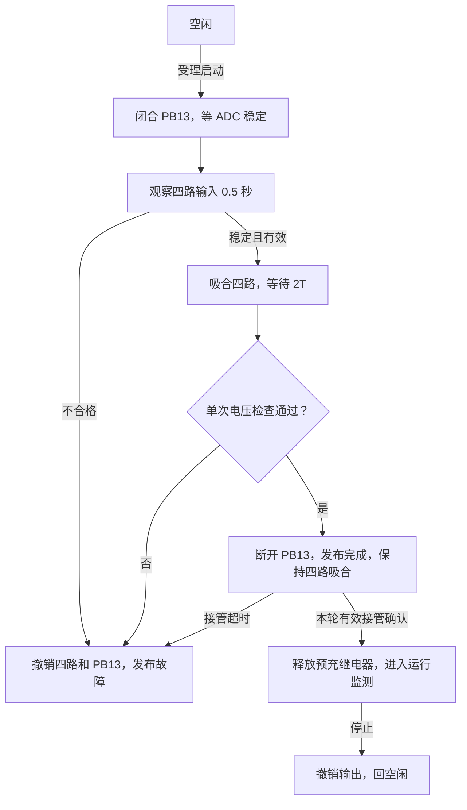
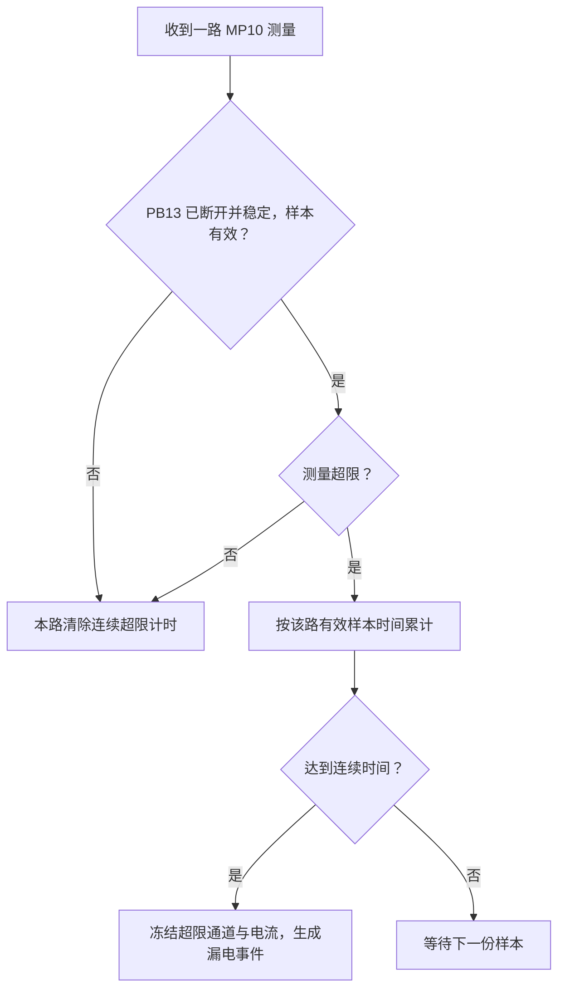

# 四路预充任务设计说明

**V0.1 · 评审稿 · 2026-11-25**

本文定义预充板中预充任务的拟定实现。预充任务负责四路电压检测、预充继电器、PB13、MP10 自检和漏电判断，以及运行灯。485 任务是接口调用方，主板负责整机联锁及旁路接触器。

## 1. 模块结构

| 文件（拟定） | 职责 |
|---|---|
| `inc/precharge.h` | 启动入口、控制请求及结果事件 |
| `precharge/precharge.c` | 任务入口、预充状态机、运行灯及跨任务接口 |
| `precharge/mp10.c/.h` | CAN 收发、自检、测量解码和四路漏电计时。头文件为模块私有 |

四路共用一个预充线程和一套阶段。每轮先处理停止和到期的控制动作，再处理有限量的 MP10 事件，最后更新运行灯、喂看门狗并等待下一轮。等待 0.5 秒、2T 和接管均通过截止时间推进，期间继续受理停止及处理 CAN。

板级初始化先将输出置为非有效态并准备 ADC、GPIO、CAN。应用创建任务后，预充线程注册看门狗、建立 MP10 接收，再发布就绪信息和四路初始可用性。必需的 GPIO、ADC 或任务监控初始化失败时拒绝启动。MP10 初始化失败按四路不可用发布，由主板决定是否下发启动。

## 2. 预充控制流程



| 阶段 | 动作和判断 |
|---|---|
| 空闲 | 允许受理一轮启动。输出撤销失败将锁定启动，解除条件待定 |
| ADC 稳定 | 闭合 PB13 后开始等待。达到稳定时间再开始输入观察 |
| 输入观察 | 0.5 秒内记录四路输入电压范围及有效采样覆盖，检查采样有效性和电压稳定性 |
| 等待 2T | 四路吸合操作均成功后开始计时。暂按 1.4 秒，在到点后的有效采样上只判一次。四路输入均须大于 200 V，各路前后绝对压差均须小于 30 V |
| 等待接管 | 断开 PB13 后发布完成事件，保持四路吸合。联调暂按事件发布起 3 秒。主板确认旁路实际吸合后应答，预充任务验证本轮确认再撤销四路。超时按联调约定撤销并上报 |
| 运行监测 | 预充输出已撤销，主板旁路承担负载。预充任务继续判断漏电，收到停止后结束本轮 |

200 V 下限只用于 2T。输入稳定性按硬件流程的 10% 界限评审，计算基准及有效采样数量待定。四对回读使用同一轮 ADC 数据，按硬件公式 `V高压 = (1.5 − V引脚) × 3441 ÷ 2` 换算，两侧单位均为 V。

任一活动阶段收到停止均优先处理。停止、检测失败、继电器吸合失败和接管超时共用撤销流程。一路释放失败仍尝试释放其余输出，故障结果保留初始原因和撤销失败信息。GPIO 操作结果和实际触点状态分别验证。2T 等待期间需要提前中止的异常及撤销时限仍待确认。

## 3. MP10 与漏电流程

| 通道 | 测量 ID | 自检请求 ID | 自检应答 ID |
|---|---:|---:|---:|
| 1 | 0x23D | 0x46A | 0x46B |
| 2 | 0x23E | 0x47A | 0x47B |
| 3 | 0x23F | 0x48A | 0x48B |
| 4 | 0x240 | 0x49A | 0x49B |

四台模块上线后逐台执行一次上电自检。发送 `44 03`，对应 ID 回复 `51 44` 表示通过，`7F 44` 表示失败。发送或等待应答超时后记录该路结果并继续处理其余设备。迟到回调和应答按通道与当前请求匹配。掉线、自检失败、设备故障或采样过期使该路不可用，状态变化交给主板。主板启动前如何取得初始状态及不可用状态的线协议编码需联合评审。



自检恢复窗口内的样本不参与判定。PB13 闭合期间继续收报文并停止累计，释放并稳定后，只用随后收到的新样本。等待接管和运行监测共用判定逻辑。首版包含漏电判定及事件上报闭环。阈值、持续时间、样本最大间隔、恢复及再报告规则待补充。等待接管期间确认漏电后的输出动作暂列待定。

## 4. 对外接口与调用方式

以下为拟定签名，均由线程上下文调用。

```c
int precharge_start_task(void);
int precharge_request_start(void);
void precharge_request_stop(void);
int precharge_confirm_handover(uint32_t completion_id);
int precharge_take_event(precharge_event_t *event);
```

| 接口 | 调用方与契约 |
|---|---|
| 启动任务 | 应用在板级初始化完成后调用一次，返回创建结果。任务是否已就绪由启动请求接口反馈 |
| 请求启动 | 485 收到启动命令时调用。返回 0 已受理、负值忙或未就绪。取走请求时同步发布运行状态，避免重复受理 |
| 请求停止 | 485 提交停止，可重复调用。预充线程消费后执行撤销 |
| 确认接管 | 485 匹配主板应答后原样传回完成事件的本地标识。返回 0 已受理、负值表示无匹配的有效轮次或超时 |
| 领取事件 | 485 传入有效输出地址，返回 1 已复制、0 暂无事件、负值参数无效。返回后副本由 485 保存 |

完成事件含本地 `completion_id`。故障含原因及适用的通道位图。漏电事件含超限位图和对应电流（0.1 mA）。MP10 可用性事件含四路位图。示例调用顺序：

```text
收到主板启动 -> request_start() -> 回复受理结果
take_event() 取得完成 -> 保存完成标识并发送完成通知
收到匹配应答 -> confirm_handover(保存的标识)
take_event() 取得漏电或故障 -> 发送结果并处理该报文的应答
```

接管记录在停止、超时或完成释放时失效。485 已领取的旧事件即使已经发出，返回的确认仍须通过预充任务检查。拟定复用事件入口交付带同一标识的取消事件，供 485 终止尚未开始的发送和后续重发。布线上已经发出的字节无法撤回。

## 5. 依赖的其他模块接口

| 提供方 | 需要的能力 |
|---|---|
| GPIO BSP | 按逻辑状态写指定继电器、PB13 和运行灯，返回操作结果 |
| ADC BSP | 提供四对配对电压、采样时刻和有效性的一轮快照。时间和有效性是拟定契约 |
| Zephyr CAN | 注册接收过滤与回调，异步发送自检请求，回调交付帧或发送结果 |
| 任务看门狗 BSP | 线程入口注册，每轮工作完成后喂狗 |
| Zephyr 内核 | 单调时钟、线程调度、互斥锁和中断事件交付 |

## 6. 全局变量和数据归属

| 范围 | 保留的数据与访问规则 |
|---|---|
| 文件级私有共享区 | 待处理动作、事件槽，以及受理和确认需要的阶段与接管记录。一个互斥锁保护。GPIO、ADC 和串口处理均在锁外 |
| 文件级 RTOS 和回调资源 | 线程栈、线程对象、CAN 回调缓冲及丢弃计数。只读 CAN ID 表也是文件级对象 |
| 任务局部 | 四路电压统计、MP10 最新测量、自检和超限计时、运行灯计时。每轮由本任务推进 |

阶段只维护一套，接管截止时间只保存在本轮接管记录中。启动资格由阶段、待处理动作和撤销故障推导。结果在事件产生时冻结，后续采样不覆盖该事件。拟定完成和终止故障分槽，MP10 可用性保留最新状态，待领取的漏电按通道合并。终止故障槽已有结果时拒绝新一轮启动，直到 485 领取，避免连续失败覆盖。485 已领取的报文副本及重发状态归 485。

调试版保留 PB3～PB6 Shell 直控，由实验人员隔离自动流程。恢复自动测试前先回到断开状态。

## 7. 验证与参考

| 验收场景 | 观察结果 |
|---|---|
| 四路正常与主板接管 | PB13 先闭合，2T 只作一次判断，检查后断开 PB13，匹配确认后才释放四路 |
| 四路稳定在 180 V | 采样有效时可通过输入观察，到 2T 仍为 180 V 则失败 |
| 单路检查失败或释放失败 | 尝试撤销全部输出，上报原因。释放失败后拒绝启动 |
| 重复启动、停止、迟到确认及旧完成重发 | 无重复受理。停止优先，旧确认无效 |
| MP10 单路不可用 | 对应位图通知主板，其他通道继续监测 |
| PB13 稳定前后、短时与持续超限 | 仅有效新样本参与判定，达到持续条件后交付漏电事件 |

设计依据为[主板通信协议评审稿](主控板与预充板通信协议-V0.1.md)、[板级硬件说明](Precharge_Hardware.md)、硬件预充检测流程、MP10 手册与供应商答复，以及四台设备的自检联调记录。文档结构参考 C2《PTL 设计和使用说明》。

评审待定项包括输入波动算法及采样有效条件、PB13 两侧稳定时间、2T 调度偏差与输出撤销时限、正式接管超时处置、MP10 可用性编码，以及漏电参数和联动策略。文件拆分、接口命名、取消事件与事件槽策略均为本稿提出的设计。
